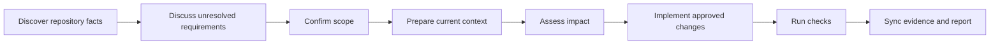

# GraphWard

**Repository context, requirements and verification for AI coding agents.**

GraphWard helps coding agents understand existing behavior, clarify a request, identify affected callers and tests, and record what was validated. It combines project-owned knowledge, dependency graphs and current source evidence. It does not replace your assistant or guarantee correct code or complete dependency coverage.

> **Current source candidate — October 26, 2026:** this checkout declares package version `1.3.3`. This identifies local source, not a published release or a running IDE process. Use `gw --version` for the invoked version and MCP `provider_status.runtime` for the loaded process/build generation. Native host, remote platform and measured outcome qualification remain separate from local tests.

## Start here

- New project: [install and initialize](#install-and-initialize), then [activate your coding agent](#activate-your-coding-agent).
- Existing installation: read [updating an existing project](#updating-an-existing-project) before migration.
- Agent skips questions/context: use [troubleshooting](#troubleshooting).
- Proposed interface: see [planned CLI upgrade](#planned-cli-upgrade).

## What GraphWard adds

| Capability | Purpose |
|---|---|
| Requirements discovery | Discuss features, record intended behavior/acceptance criteria and clarify fixes proportionally. |
| Current context | Retrieve source through CCE or a disclosed native fallback within project file policy. |
| Architecture evidence | Combine Graphify evidence and GraphWard's normalized graph to find relationships, callers and possible ripple effects. |
| Task readiness | Check project/task identity, confirmed requirements revision and prepared context before supported edit paths. |
| Verification | Run real project checks and bind results to checked bytes; missing checks cannot establish success. |
| Continuity | Keep inspectable knowledge, decisions, context, evidence and change history. |

Results depend on integration, context coverage, requirements quality and meaningful tests.

## Install and initialize

### Requirements and runtime

- Node.js **20.11+** and npm; your chosen coding agent.
- Managed providers require `uv` and **Python 3.11+**. CCE may need C/C++ build tools and CMake when compatible wheels are unavailable.
- Network access for missing package/provider dependencies and potentially model assets.
- Current pins: **Graphify 0.9.29**, **CCE 0.4.25**. Replacement versions need compatibility qualification.

Install a published release:

```bash
npm install --global graphward
graphward --version
```

This does not obtain unpublished repairs from this checkout. To use source, run inside the GraphWard repository:

```bash
npm ci
npm run build
node dist/cli/index.js --help
```

From a target project, invoke the identified source runtime:

```bash
node /absolute/path/to/graphward/dist/cli/index.js --help
```

The examples below use `graphward`; substitute that absolute Node invocation for source testing. `gw` is an alias only when it resolves to the intended installation. Avoid ambiguous `npx gw`; explicitly name the package for temporary execution:

```bash
npm exec --package=graphward -- graphward --help
```

Temporary execution can fetch a published copy. It is not an offline command or proof that this candidate is being used.

### Fresh project setup

Run inside your application repository:

```bash
graphward initialize . --ide codex --providers auto --yes
```

Use `--ide claude-code`, `--ide antigravity` or `--ide antigravity-cli` for those hosts. Repeat `--ide` to select multiple adapters. Without explicit selection, project/user markers suggest adapters; markers do not prove a host is active.

Then ask the coding agent to **initialize GraphWard**, or invoke its installed `initialize-graphward` entry workflow, to enrich verified knowledge from bootstrap evidence.

| Entry | What it does |
|---|---|
| `install` | Generate managed skills, instructions and supported host configuration. |
| `initialize` | Install integration; prepare provider evidence, graph and bootstrap artifacts. |
| Agent's `initialize-graphward` | Synthesize and validate richer project knowledge. |
| `setup` | Best-effort convenience orchestration; inspect health rather than assuming every stage succeeded. |

To select adapters, include every adapter you want to retain. This can replace the managed adapter set; omitting an earlier adapter can remove its unchanged generated assets:

```bash
graphward install . --ide codex --ide claude-code --yes
```

On existing projects, installation/setup also affects managed assets; the migration blockers below apply there too.

### Provider policy

| Option | Meaning |
|---|---|
| `--providers auto` | Use compatible providers and disclose fallback; initialization can install missing dependencies. |
| `--providers full` | Select provider-backed context; this alone does not require providers. |
| `--providers full --require-providers` | Missing/unhealthy required providers fail; retrieval cannot silently substitute native context. |
| `--providers native` | Use native GraphWard context without CCE/Graphify invocation. |
| `--offline` | Prevent provider downloads during initialization, not npm downloads of GraphWard itself. |

```bash
# Native context without provider downloads.
graphward initialize . --ide codex --providers native --offline --yes

# Require provider-backed context.
graphward initialize . --ide codex --providers full --require-providers --yes
```

Configuration lives in `.graphward/gw.config.json`. Provider binaries and current project indexes are separate. Ordinary retrieval never installs dependencies.

## Activate your coding agent

Open the correct project, reload host configuration as needed, verify skills/MCP discovery and complete native permission/trust review. Generated files alone do not establish activation.

| Host | Workflow entry |
|---|---|
| Claude Code | Installed `/graphward <request>` command/skill. |
| Codex | Ask to apply GraphWard or select its installed `graphward` skill. Inspect the project's custom-agent manifest; do not assume a desktop slash command exists. |
| Antigravity IDE / CLI | Installed entry skill or an explicit request to apply GraphWard. Qualify IDE and CLI separately. |
| Other adapters | Host-discovered skill/command or portable instructions; inspect its capability profile. |

```text
Apply the GraphWard workflow to add invoice PDF export.
Use scope-requirement to define export behavior before implementation.
Use analyze-impact to review changes to the invoice service.
```

Codex requires native review of the **exact generated hooks**, not just project trust. Changed definitions need review again. Disabled hooks remain disabled until deliberately enabled. Other hosts have their own discovery/permission rules. GraphWard preserves model/reasoning settings; the experimental automatic model router remains removed.

### Support and qualification

| Adapter ID | Current category |
|---|---|
| `codex` | Primary target; current-candidate native qualification open. |
| `claude-code` | Primary; recorded exact-candidate canary passed. |
| `antigravity` | Primary IDE target; native qualification open. |
| `antigravity-cli` | Primary CLI target; native qualification open. |
| `cursor` | Generated integration; native qualification pending. |
| `github-copilot` | Pending; VS Code Local, CLI/Agent Host and cloud differ. |
| `gemini-cli` | Qualification pending. |
| `commandcode` | Qualification pending. |
| `cline` | Pending; extension/CLI provisioning differ. |
| `roo-code` | Legacy compatibility. |
| `generic` | Portable instructions; no native connectivity/enforcement claim. |

The 11 profile definitions live in `src/adapters/capabilities.ts`; profiles for installed adapters are generated under `.graphward/providers/hosts/`. Track **generated → discovered → enabled → connected → invoked → enforcement tested** separately. A generated profile does not establish later stages.

Hooks are guardrails with host-specific coverage. Shell/specialized tool paths can escape normal handling; there is no universal edit-prevention guarantee.

## Requirements-first workflow



**Every feature** gets discussion of users, behavior, non-goals, acceptance criteria, compatibility and relevant failure cases. Detailed features still get scope confirmation. **Fixes** clarify proportionally; a typo should not trigger an architecture interview. Reuse earlier answers; ask again for unresolved choices, contradictions or material scope changes. Discover repository facts before asking the user what the code already answers.

Versioned `TaskDecisionReceipt` files under `.graphward/aidlc/tasks/` bind project, task and requirements revision. They retain full questions/answers, scope, acceptance criteria, confirmation provenance and context generation. Empty documents, stale approvals or assistant assertions of approval cannot satisfy readiness. Confirmation assurance is labelled according to what the host can actually establish.

Ordinary edits within approved intent refresh context without repeatedly revoking scope confirmation. Concurrent tasks have separate receipts. Subagents return unresolved questions to the parent rather than approving themselves.

Track **requirement → changed files → validation**. Review missing consumers/failure cases and unnecessary additions, not just compilation. Whether ordinary host requests follow this contract depends on discovered integration, permissions and verified hook coverage.

### Opt-in concise workflow

Strict is the default for existing and new configurations. To try the shorter workflow, merge this setting into `.graphward/gw.config.json`, keeping your other settings:

```json
{
  "workflow": { "mode": "concise" }
}
```

Preview `graphward update . --dry-run`, then update the project to refresh its managed agent instructions. Ordinary concise work uses one working agent, scoped context, a short impact/acceptance record, applicable verification and affected intelligence sync. Complex or high-risk work and explicit backlog delivery retain their required lifecycle and specialist checks. Missing or invalid mode values resolve to strict.

Read, discussion and planning requests do not authorize edits. Both modes retain native permissions, task readiness, freshness, project scope and real verification. In concise mode, Stop can disregard pre-existing dirty source only when complete session tracking shows that the session stayed read-only and the source/Git/configuration state is unchanged. Missing or uncertain tracking keeps the verification requirement.

Concise mode is experimental. Local regression tests establish behavior; token savings and coding accuracy still require the separate measured experiments.

## CCE, Graphify and source inspection

- **CCE:** current source spans inside approved file scope.
- **Graphify:** structural evidence about modules/relationships.
- **GraphWard:** canonical knowledge, claims, decisions, memory and normalized graph; checks policy, freshness and provenance before accepting evidence.

Agents normally use consolidated GraphWard tools. Separate visible raw provider calls are unnecessary when receipts show actual invocation and accepted contribution.

**Retrieve context first, then inspect actual code and tests selectively.** Missing graph edges can justify broader read-only search. Retrieval scope does not authorize unrelated edits; direct file reading is still necessary.

```bash
# Explicit preparation can refresh indexes and graph artifacts.
graphward aidlc prepare-task . --force --yes

# Read-only retrieval.
graphward context "Explain invoice export and its callers" . --budget 5000 --json --yes
```

After confirmed requirements, the workflow adds `--id <task-id>` to bind preparation. A task ID alone is not approval. Preparation makes one bounded local recovery attempt; retrieval does not rebuild or download dependencies.

Receipts distinguish binary identity, index generation, invocation, accepted contribution, rejected spans and fallback reasons. Required-provider failure blocks implementation; reduced coverage requires a task-scoped decision. Zero accepted contribution does not prove a provider helped.

## Updating an existing project

> **Open blockers:** this candidate can overwrite custom `.graphward/.gitignore` rules and replace malformed `.graphward/gw.config.json` with defaults during update. Both were reproduced in a disposable project. Fixes/regressions are required before rollout; current migration is not universally safe or transactional.

Keep these separate: **running package identity**, **project integration revision**, **context source generation** and **native activation**. A package upgrade does not regenerate every project's skills/hooks/config. A shared source-linked runtime can change immediately while generated project files remain old; cached copies can retain older code.

After those blockers are fixed, use a qualified runtime for this intended per-project sequence:

```bash
# Preview; resolve conflicts before applying.
graphward update . --dry-run --yes
graphward update . --yes

# Refresh context and inspect health.
graphward aidlc prepare-task . --force --yes
graphward doctor . --json --yes
graphward providers status . --json --yes
graphward health . --strict --json --yes
```

`update . --yes` reuses manifest-selected adapters; interactive update can ask for selection again. Unchanged managed files are replaced; edited files/obsolete edited content remain conflicts. Host JSON merging preserves unrelated settings and explicit disabled state in tested layouts. Resolve conflicts deliberately; avoid routine `--force` overwrites.

Current dry-run previews file actions, not complete malformed-config validation. Review changed native hooks, global/project skill collisions and entry discovery after migration. Legacy requirements remain history, not new-task approval. Representative fixture tests do not qualify every historical package or your other projects.

## Everyday commands

Use an identified runtime in the intended project. `--yes` suppresses current CLI prompts; it does not approve task scope or grant hook trust.

| Command | Purpose |
|---|---|
| `graphward --help` / `--help --all` | Core/advanced reference. |
| `graphward doctor . --json --yes` | Installation/configuration inspection. |
| `graphward providers status . --json --yes` | Binary versus project-run health. |
| `graphward freshness . --json --yes` | Artifact freshness. |
| `graphward health . --strict --json --yes` | Intelligence health. |
| `graphward verify . --json --yes` | Execute project checks and record verification. |
| `graphward claims verify . --strict --json --yes` | Claim validation. |
| `graphward evidence-check . --strict --json --yes` | Citation/source hashes. |
| `graphward sync . --files src/invoice.ts,test/invoice.test.ts --json --yes` | Refresh affected evidence; prose may need agent synchronization. |
| `graphward visualize . --open --yes` | Existing architecture visualization. |
| `graphward prune . --ttl-days 30 --yes` | Expired constraints/attempt records. |

Agent entries include `initialize-graphward`, `graphward`, `scope-requirement`, `analyze-impact`, `map-architecture`, `sync-graphward`, `review-engineering-change` and `handoff`. Use the host's actual invocation mechanism. `decompose-backlog` plans Epic → Feature → Ticket work; `deliver-backlog` implements approved features. Planning alone does not authorize edits.

## Verification and limits

Configure real checks in `.graphward/gw.config.json`:

```json
{
  "hooks": {
    "verifyCommands": ["npm test", "npm run lint"]
  }
}
```

Use commands that exist in your project. Supported package scripts can also be detected. **Zero executed checks cannot establish a pass.** Baseline/preflight do not generate product code/tests to manufacture success.

Verification preserves original exit status and reports failures/timeouts. Version 3 receipts bind canonical project/HEAD, checked bytes, required commands, configuration inputs, actual command/timeout/mode selection, and the finalized implementation generation. Source, check, configuration or runtime changes invalidate reuse. Legacy receipts remain history; re-run checks to obtain current evidence. Explicit custom checks report their own results and cannot substitute for omitted required baseline checks.

When no checks exist, the default Stop policy remains blocking. Projects may explicitly configure `hooks.unavailableValidationPolicy: "allow-explicit"`; a native user message `Validation is unavailable; no check commands are configured.` then records an unavailable outcome for that session and exact source/check state. This permits an honest final report and never establishes a validation pass or waives configured failures.

Security and convention artifacts require completed, dated, attributed reviews with current source/scope/runtime bindings; see [the review schema](schemas/review-evidence.schema.json) and `createReviewBinding` in `dist/gates/review-evidence.js`. Empty, pending, unrelated or stale evidence stays unavailable. API snapshot v2 capture/replay binds source, request baseline and runtime generation; replay checks supplied response data and does not itself prove that an endpoint executed.

Failed validation does not guarantee automatic rollback. Repair or report the failure while preserving unrelated local edits. File restoration cannot undo external effects of scripts, tests or agent tools. Local checks, native canaries, measured accuracy and release qualification are distinct evidence.

## Files, privacy and execution

| Area | Actual behavior |
|---|---|
| Reads | Approved project source/config and Git evidence. File policy excludes known sensitive/generated/vendor/cache paths and escapes; arbitrary secrets embedded in source are not guaranteed excluded. |
| Writes | `.graphward/`, managed host files/settings and instructions such as `AGENTS.md`/`CLAUDE.md`. |
| Processes | Providers, Git analysis and configured checks; installation invokes package tooling. |
| Network | Package/provider/model downloads may use the network. Coding hosts and project checks can contact services. |
| Data | Core artifacts stay local; model-provider disclosure follows the coding host's configuration/permissions. |

Local tooling does not guarantee no data leaves the machine. Checks are not container-isolated. Not every artifact writer scans for secrets.

Dashboard export uses an explicit contained artifact inventory and excludes private profiles, task answers, caches and runtime state. Repository Markdown renders with raw HTML and external resource loading disabled, and diagrams use strict rendering. Experiment rollback requires a captured pre-edit baseline, preserves index state, and refuses to overwrite later candidate drift. Isolated measurement identifies the copied candidate and keeps skipped or unavailable verification visible. Metric `KEEP` alone cannot establish a verified result.

Default `.graphward/.gitignore` excludes several content-derived areas, including knowledge, graphs, claims, context, reports, provider caches and user memory. It does not make all lifecycle/change records private. Inspect actual Git ignore/tracking state before sharing. Current `--share` is not wired through CLI paths as a validated redacted export; do not rely on it for safe publication.

| Path under `.graphward/` | Contents |
|---|---|
| `gw.config.json`, `install-manifest.json` | Configuration and managed integration identity. |
| `knowledge-base/`, `context/`, `memory/` | Facts, navigation and decisions. |
| `graph/`, `claims/` | Architecture evidence and claims. |
| `providers/` | Provider/preparation state and host profiles. |
| `aidlc/`, including `aidlc/tasks/` | Lifecycle, backlog and task receipts. |
| `reports/`, `flight/`, `changes/`, `events/` | Impact, execution, validation and continuity. |

Artifacts are inspectable files; some provider/runtime storage is binary. Deleting state can require reinitialization, indexing and fresh confirmation.

## Language coverage

Dependency extraction supports TypeScript/JavaScript, Python, Go, Rust, Ruby, Java and Kotlin to varying depths. Compiler-backed TypeScript/JavaScript paths resolve aliases and semantic calls when configuration is available; lexical extraction and optional tree-sitter parsers provide other coverage.

Dynamic calls/imports, unsupported languages, incomplete configuration and unresolved relationships remain gaps. Missing edges do not prove a module is unaffected. Confidence is estimated, not empirically calibrated coding accuracy.

## Troubleshooting

| Symptom | Next action |
|---|---|
| `gw: Permission denied` | Identify the executable/symlink target and package. Source builds can run via `node /absolute/path/to/graphward/dist/cli/index.js --help`. Rebuild/reinstall that package; do not change unknown targets. Old copies do not automatically receive the launcher repair. |
| macOS lacks `timeout` | GNU `timeout` is unnecessary for normal commands; runtime checks/provider processes have internal timeouts. |
| Agent skips feature questions | Invoke the entry explicitly; inspect adapter discovery, old/global skill collisions, task binding and hook trust. |
| Providers installed but unused | Inspect binary/project-run health, prepare context and review accepted spans/nodes, rejections and fallback. |
| Agent reads files directly | Expected after context retrieval; inspect whether searches follow callers/contracts/tests or coverage gaps. |
| MCP points at another project | Inspect canonical project root/runtime registration. Another project's indexes are invalid task evidence. |
| Update conflicts | Preserve custom content, review diffs and account for preservation blockers; avoid routine force overwrite. |
| No verification commands | Configure meaningful `hooks.verifyCommands`; do not generate tests merely to pass baseline. |
| Codex approval is visible but readiness remains unconfirmed | Send the displayed approval challenge as a plain chat message. The app's wrapped question replies are not currently ingested by the Codex confirmation hook; do not fabricate a receipt. |
| A host exposes only a bare MCP tool name | Recovery names require the exact GraphWard server namespace. A bare name such as `MCP:propose_task_contract` cannot establish that identity and remains gated. Qualified tools are required to propose tasks; there is currently no CLI proposal command. Existing tasks support CLI preparation and interactive operator confirmation. |
| Setup exits but integration is incomplete | Inspect providers and six native support stages; best-effort completion is not readiness proof. |

## Planned CLI upgrade

**Not implemented:** `gw` without arguments currently prints help. The scoped next interface provides:

- Guided home for the **current project**, with one obvious next action.
- Setup wizard confirming agents and recommending CCE plus Graphify.
- Download/prerequisite and file-change review before applying.
- Update previews/diffs, customization preservation, conflicts and guarded recovery.
- Actionable diagnostics and targeted repair.
- Separate runtime, integration, context and activation status.
- Real progress/cancellation; advanced logs/details on demand.
- Shared wizard/headless operation logic with clean JSON and no-input/plain modes.

First fix preservation defects, then deliver the operation/status layer, interface and exact-package terminal/host qualification. Existing commands remain available. Proposed `--no-input`/`--plain` flags are **not current supported flags**.

The simulated concept passed 21 screen/state checks, including offline setup, invalid configuration, conflicts, cancellation and narrow layouts. That is concept validation, not real terminal execution.

## Development and qualification

```bash
npm ci
npm run build
npm test
npm run test:integration
```

Recorded reliability evidence from **October 11, 2026**:

- 488 tests passed in final local byte-bound verification.
- Real MCP SDK initialization/discovery and read-only calls were tested.
- A Claude Code exact-candidate canary asked feature questions, accepted provider contribution and denied an unapproved mutation.
- Five exact Codex checkout hooks were reviewed and reported trusted/enabled.

Evidence applies to its recorded candidate/scenarios, not future packages or every host path. Current-candidate Codex/Antigravity qualification, wider platform evidence and held-out measurements remain open. The subsequent preservation defects were not covered by the passing suite.

Agent accuracy/performance remain unqualified until measured held-out runs are available:

```bash
# Disposable, isolated deterministic checks; no models.
npm run test:benchmark -- --dry-run

# Evaluate measured paired runs with matching identities.
node scripts/evaluate-agent-runs.mjs --results measured-runs.json
```

Evaluation accepts a version 2 envelope with a preregistered held-out task/check protocol, its hash, paired records and contained hash-verified executed-check artifacts. It requires the complete frozen sample, at least 20 pairs across 3 repositories, and identical task/oracle/check identities between arms. Those floors are release policy, not a statistical power claim. Legacy arrays are nonqualifying. Valid supplied evidence establishes record consistency; provenance and genuine accuracy/performance improvement still require independent measurement. Missing evidence blocks qualification; simulations are not measured successes.

Context JSON, Markdown and full payloads account for complete serialized output and expose omitted counts or irreducible budget overflow. Estimates use the documented character heuristic; MCP transport/model usage are separate. Resource, coverage, storage and runtime helpers expose their local or degraded capabilities; they do not establish active provider throttling, measured coverage or durable storage when those facilities are unavailable.

The separate efficiency evaluator is maintainer-checkout tooling; it is not included in the installed package. It describes matched `baseline`, `current`, and `simplified` arms and includes failed attempts, retries, and maintenance in processed tokens per accepted task, with cost and latency reported separately. Every result has `releaseQualification: false`; pilot and development observations cannot qualify a release. See the [efficiency experiment protocol](benchmark/efficiency/PROTOCOL.md) before collecting runs.

```bash
node scripts/evaluate-efficiency-runs.mjs --spec frozen-efficiency-spec.json --results measured-efficiency-runs.json
```

`graphward telemetry` reports observational cohorts. Missing token categories, unsupported host formats, and unknown child transcript accounting remain incomplete. Explicit authorized child manifests and complete category accounting are required by `usageFromTelemetry` before a sample can enter a complete efficiency comparison; no raw prompt content is stored in the telemetry log.

Schemas: [schemas/](schemas/). Further background: [WORKFLOW_GUIDE.md](WORKFLOW_GUIDE.md), [graphward-blueprint.md](graphward-blueprint.md). Use this README's current-candidate status/contracts when assessing behavior and qualification.
